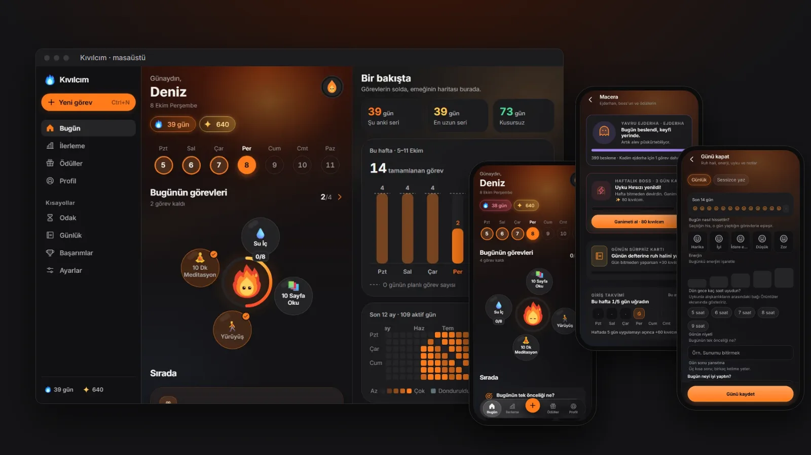
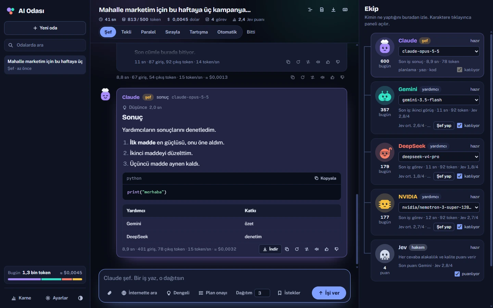

## Kıvılcım

Kıvılcım'ı yapıyorum: küçük görevleri alev alev bir seriye dönüştüren bir alışkanlık uygulaması. Hesap istemez, sunucusu yoktur; kayıtlar cihazda kalır. Windows, Mac, Linux ve Android'de çalışıyor; iPhone sürümü yolda.

&nbsp;
&nbsp;

 

### Kıvılcım'ın kuralları

<table>
  <tr>
    <td width="25%" valign="top">
       
      <b>Hesap yok</b> 
      Kayıt, e-posta, sunucu yok. Paylaşım QR ya da kodla, cihazdan cihaza.
    </td>
    <td width="25%" valign="top">
       
      <b>Küçük adım</b> 
      Her gün bir tik alevi büyütür. Seri uzadıkça Kıvı'nın rengi değişir.
    </td>
    <td width="25%" valign="top">
       
      <b>Suçlama yok</b> 
      Seri kırılınca ceza yok; son 30 günün tutarlılığı ve "tekrar hoş geldin".
    </td>
    <td width="25%" valign="top">
       
      <b>Herkes için</b> 
      Ekran okuyucu, sade hareket, renk körü dostu işaretler, büyük yazı.
    </td>
  </tr>
</table>

### Nerede

- **Tanıtım sitesi:** [yigit2015.github.io/kivilcim-indir](https://yigit2015.github.io/kivilcim-indir/)
- **İndirmeler:** [kivilcim-indir](https://github.com/yigit2015/kivilcim-indir) deposunun [Releases](https://github.com/yigit2015/kivilcim-indir/releases) sayfası
- **Sürüm notları:** [her sürümde ne değişti](https://yigit2015.github.io/kivilcim-indir/surumler/)
- **Destek:** [sık sorulanlar](https://yigit2015.github.io/kivilcim-indir/destek/) ya da destekkivilcim@gmail.com

## AI Odası

AI Odası'nı da yapıyorum: birden çok yapay zekâyı tek ekranda birlikte çalıştıran bir ekip odası. Bir şef işi dağıtır, yardımcılar yazar, bir hakem her cevabı puanlar; kimin ne yaptığı ve ne harcadığı canlı görünür. Kendi API anahtarlarınla, kendi bilgisayarında çalışır.

Görüntü uygulamanın anahtarsız deneme modunda çekildi; içindeki cevaplar örnek metindir.

### AI Odası'nın kuralları

<table>
  <tr>
    <td width="25%" valign="top">
       
      <b>Şef dağıtır</b> 
      İşi şefe verirsin; şef parçalara böler, uygun yardımcıya dağıtır, tek cevap yazar.
    </td>
    <td width="25%" valign="top">
       
      <b>Hakem puanlar</b> 
      Her cevap alakalılık ve kalite puanı alır. Puan düşükse ikinci görüş istenir.
    </td>
    <td width="25%" valign="top">
       
      <b>Hiçbir şey gizli değil</b> 
      Kim bağlanıyor, düşünüyor, yazıyor; kaç saniye, kaç token: hepsi ekranda.
    </td>
    <td width="25%" valign="top">
       
      <b>Anahtarlar sende</b> 
      Anahtarlar bilgisayarında kalır, tarayıcıya geri gönderilmez. Arada sunucu yok.
    </td>
  </tr>
</table>

Henüz herkese açık değil; tanıtım sitesi hazırlanıyor.

## Nasıl yapılıyor

Kıvılcım Expo ve React Native ile TypeScript'te yazılıyor; hareketler Reanimated, semboller Phosphor. Masaüstü sürümü Electron kabuğunda aynı kodu çalıştırıyor. Tanıtım sitesi derleme adımı olmayan düz HTML ve CSS; hareketleri GSAP veriyor, dışarıya tek istek atmıyor.

AI Odası bağımlılıksız bir Node sunucusu ile düz HTML, CSS ve JavaScript; derleme adımı yok. Karakterleri elle çizilmiş SVG.
